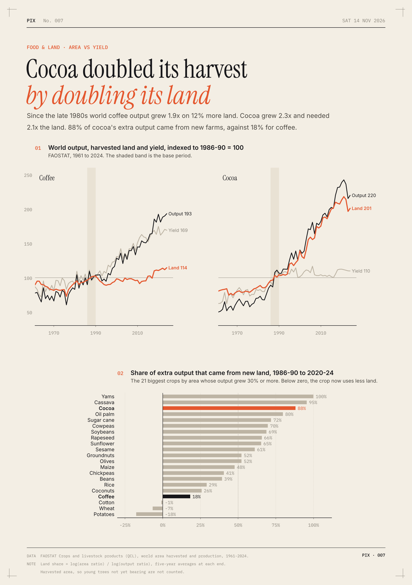

Every morning at 8:05 Eastern, a Claude Code scheduled task starts a fresh session, reads a brief I wrote, and publishes one chart to [pix](https://github.com/mkearney/pix). It picks the topic and finds the data. It writes the analysis in Python, draws the chart, writes a short post, and pushes it all to GitHub. Nobody touches it in between.

The first entry went up on November 8. It found that [four earthquakes released half this century's quake energy](https://github.com/mkearney/pix/blob/main/archive/2026-11-08-quake-energy/post.md). Of 3,996 quakes of magnitude 6 or bigger since 2000, the top four released 49 percent of the energy. Another showed that [the world's clocks run fast](https://github.com/mkearney/pix/blob/main/archive/2026-11-11-clocks-run-fast/post.md). For most people the sun peaks after noon, and 38 percent see it peak at 12:30 or later. A third found that [last year the world added a South Korea of solar power](https://github.com/mkearney/pix/blob/main/archive/2026-11-09-solar-adds-a-country/post.md). New solar built in 2025 made 636 terawatt-hours, about as much electricity as South Korea makes in a year.

## The brief

Most of the work went into `CLAUDE.md`, the standing brief the agent reads every morning. The model already knows how to use pandas and matplotlib. What it doesn't have is taste, so the brief tries to write some down.

It asks for one claim per post, stated as a sentence with a verb. "The world's clocks run fast" passes. "Time zones of the world" doesn't. The brief lists a few routes to an original angle: a question nobody asks, the agent's own computation instead of a replotted chart, counting people instead of countries, or joining two datasets that rarely meet. It also has a first-idea test. If a newsroom or an AI would pick the topic first, the agent drops it or pushes the angle two steps further.

Left alone, a model drifts toward the most average version of interesting. Two of the first five posts were shaped "X percent of people...", so the brief now calls that out as the house habit. Every entry also has to declare a claim type, like share, concentration, gap, reversal, or crossover. There are limits on how often any one type can repeat.

## Checks that run

Telling a model to be original doesn't do much on its own. So before writing any analysis code, the agent has to run at least five web searches and name the closest existing take. It writes down what its version adds and what a smart reader would naively expect. That goes in a `prior_art.md` file, and `scripts/publish.py` won't publish an entry without one.

Accuracy works the same way. Every number in a post has to come from the output of that entry's `analysis.py`. The script is saved next to the raw data, so each analysis reruns offline and anyone can check the work.

## The look

The charts share a house style called Plate, meant to look like a printed plate read on a screen. It uses warm paper and black ink, with one vermilion color for the thing to look at. There are crop marks in the corners. Headlines are set in Instrument Serif, words in Inter, and numbers in IBM Plex Mono.

The style lives in one Python module. The agent builds each chart from parts (`plate()`, `masthead()`, `headline()`, `panel()`, `footer()`) instead of fighting matplotlib's defaults every morning. The chart type changes from day to day, and the plate stays the same.

## The voice

The brief also says how to write: first person, the point first, numbers second, and at most one dry line per post. It bans a list of words like striking, notably, delve, and tapestry. It also bans em dashes and section headers like "Key takeaways." Those rules account for most of the difference between a post that reads like a person and one that reads like a press release.

Everything is public, including the brief, the style module, and the code and data behind every chart. The [archive](https://github.com/mkearney/pix/tree/main/archive) has every entry so far.
