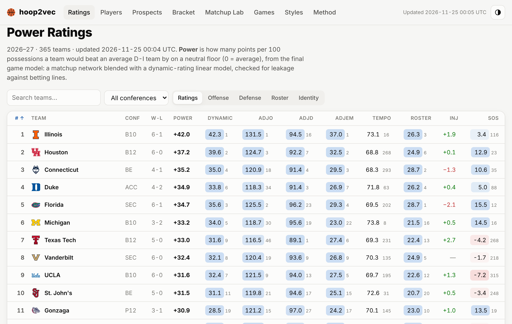

[hoop2vec](https://mkearney.github.io/hoop2vec/) is a men's college basketball site I built this fall. It rates all 365 Division I teams, forecasts every game, and updates itself every morning during the season. Everything on it comes from free public data, and it's free to use.

The site has eight tabs. Ratings ranks every team, and Players does the same for about 4,900 players. Prospects estimates who'll get drafted into the NBA and who'll last once they're there. Bracket projects the 2027 NCAA tournament and gives each team's odds of reaching each round. Games has forecasts for upcoming games, and Matchup Lab lets you set up any game yourself. Styles describes how each team plays, and Method explains how it all works.

The name is a nod to word2vec, a method that learns a list of numbers for each word based on the words that show up around it. I liked the idea of doing that for teams and players. hoop2vec doesn't actually use word2vec or anything like it, at least not yet. I kept the name anyway.

## How it got built

I've been doing some version of this for a long time. About ten years ago I put a college basketball dataset on data.world. Since then I've built a handful of rating models and used them to fill out my own brackets. None of them made it past my laptop.

From about 2014 to 2020 I made a lot of things and shared most of them, mostly on Twitter. Some were academic and some were just for fun. Then came COVID, my first kid, and a career change. There are two kids at home now, and side projects pretty much stopped.

What changed is that I can do this kind of work from my phone. I describe what I want to Claude Code, it writes the code, and I read it and push back. Most of hoop2vec was built that way, a few minutes at a time.

hoop2vec started as two separate projects. For the first, I described what I wanted and how I thought it should work, then gave Claude Code license to build it and propose improvements. The second I directed much more closely, trying the things I thought would work and keeping what did. Then I merged the good ideas from both. Where the two overlapped, I kept whichever piece tested better, and in a few places I combined them.

I don't love working this way. I like control, and I like knowing how every piece works down to the details. I have less of that here than I'd want. But I've spent a lot of years learning what makes an analysis good or bad, and this lets me put that to use much faster than I could by typing it all myself. Without it, I'd have one more rating model on my laptop.

Over the next couple of weeks I'll write a short post about each part of the site. The first one covers the ratings.
