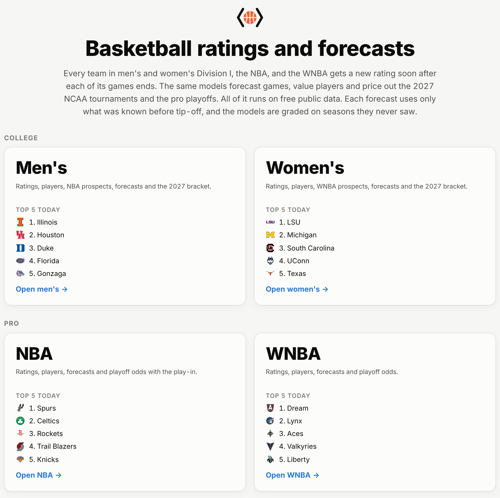

[hoop2vec](https://hoop2vec.net/) is a basketball ratings and forecasting site. It covers four leagues: men's and women's Division I, the NBA, and the WNBA. Every team gets a new rating a few minutes after each of its games ends, and the whole thing is rebuilt from scratch every morning. Every game gets a forecast, and every player gets a value. All of it comes from free public data.

Each league has the same set of pages. There's a ratings table, a list of games with forecasts, a players table, and a Matchup Lab where you can pit any two teams against each other at any site. Every team has its own page, and so does every player, with career stats and a shot chart. The college sites add NBA or WNBA draft projections and a projected NCAA tournament bracket. The pro sites have playoff odds instead. The next post walks through a team page, and the one after that covers how the forecasts get made.

## How it compares

There are a bunch of good basketball sites already. Most cover one league, and some of the best parts cost money. This is how hoop2vec lines up with the ones I use most, as of November 2026. Men's and Women's are Division I. Odds means bracket or playoff odds, and Code means the code is public. A check means free, a dollar sign means paid, and an X means the site doesn't offer it.

| Site | Men's | Women's | NBA | WNBA | Ratings | Forecasts | Players | Odds | Code |
|---|---|---|---|---|---|---|---|---|---|
| [hoop2vec](https://hoop2vec.net/) | ✓ | ✓ | ✓ | ✓ | ✓ | ✓ | ✓ | ✓ | ✓ |
| [KenPom](https://kenpom.com) | $ | ✗ | ✗ | ✗ | ✓ | $ | $ | ✗ | ✗ |
| [Bart Torvik](https://barttorvik.com) | ✓ | ✓ | ✗ | ✗ | ✓ | ✓ | ✓ | ✓ | ✗ |
| [EvanMiya](https://evanmiya.com) | ✓ | ✗ | ✗ | ✗ | ✓ | $ | ✓ | ✓ | ✗ |
| [Haslametrics](https://haslametrics.com) | ✓ | ✗ | ✗ | ✗ | ✓ | ✓ | ✗ | ✓ | ✗ |
| [ESPN BPI](https://www.espn.com/mens-college-basketball/bpi) | ✓ | ✗ | ✗ | ✗ | ✓ | ✓ | ✗ | ✓ | ✗ |
| [Her Hoop Stats](https://herhoopstats.com) | ✗ | ✓ | ✗ | ✓ | $ | $ | ✓ | ✓ | ✗ |
| [Dunks & Threes](https://dunksandthrees.com) | ✗ | ✗ | $ | ✗ | $ | $ | $ | $ | ✗ |

A check doesn't mean equal quality. KenPom and Torvik have years of trust that hoop2vec hasn't earned, and nobody has tested hoop2vec head to head against them. EvanMiya's college player ratings are more sophisticated than mine, and so are Dunks & Threes' NBA ones. A sharp sportsbook still beats hoop2vec during the regular season.

What hoop2vec has is coverage. It's the only site on the list with all four leagues, and the only one where you can read the code behind every number.

The name is a nod to word2vec, a method that learns a short list of numbers for each word based on the words around it. hoop2vec's game model does something loosely similar for teams. It learns a list of numbers for each one and uses them to score how any two teams fit together. That's close enough for me to keep the name.

## Why basketball

I used to be a big San Antonio Spurs fan, starting with David Robinson and going through the Tim Duncan years. I also went to graduate school at the University of Kansas, where I tutored players on the men's and women's basketball teams and went to a bunch of games. (I live in Michigan now, and I still crave Free State Brewing Company and Burger Stand about once a week.) These days I like pretty much all basketball.

Most of my modeling has been on men's college basketball, on and off for about ten years, going back to a college basketball dataset I put on data.world. I've tried to predict upsets. I've tried strange hybrids of Bayesian models, latent variable models, Elo, XGBoost, and a transformer fine-tuned on press coverage. A few of them filled out my brackets. I usually compared them against KenPom, and mostly what I learned is how simple and effective KenPom is. The site still looks like it's from the 90s, though.

I've always wanted a free site that shows advanced stats and is easy to get around, for every league and not just men's college basketball. That's what hoop2vec is trying to be.

## How it got built

From about 2014 to 2020 I was making things all the time and sharing most of them, a lot of it on Twitter. Some of it was academic and some of it was just for fun. Then COVID hit, I had my first kid, and I changed careers. Now there are two young kids at home, and side projects pretty much stopped.

What's different now is that I can do this kind of work from my phone. I describe what I want to Claude Code, it writes the code, and I read what it did and push back. Most of hoop2vec got built that way, a few minutes at a time.

It started as two separate men's college projects. On the first, I described what I wanted and how I thought it should be done, then let Claude Code build it and propose improvements. The second I directed much more strictly. Then I merged the good ideas from both, keeping whichever piece tested better where they overlapped. Once that worked, I carried the same approach over to the women's game, the NBA, and the WNBA.

I'm not totally comfortable working this way. I like control, and I like knowing how every piece works. I have less of that here than I'd want. But I've spent years building up expertise in analytics and data science, and this lets me use it a lot faster than typing everything myself.
