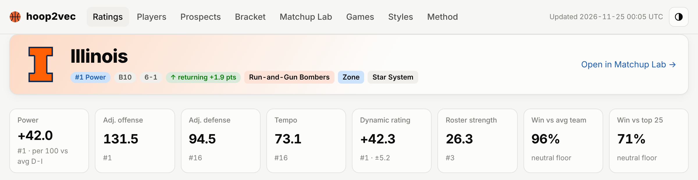

Illinois is the best team in college basketball right now, by about five points. That's according to [hoop2vec](https://mkearney.github.io/hoop2vec/), which gives every Division I team a number called Power. Illinois is at +42.0. Houston is next at +37.2, and Arkansas Pine Bluff is last at −33.4.

## What the number means

Power is how many points per 100 possessions a team would beat an average D-I team by on a neutral floor. A possession is one trip down the court that ends when the other team gets the ball. A typical game has about 70 of them for each team. So +42 means Illinois would beat an average team by about 29 points in a normal game. Zero is average.

Counting per 100 possessions takes pace out of it. A fast team that wins 90 to 70 and a slow team that wins 60 to 40 both won by 20. The slow team did it with fewer chances, so it was the more dominant team per trip.

The team pages put Power in more familiar terms too. Illinois would beat an average D-I team 96 percent of the time on a neutral floor. Against a typical top-25 team, it would win 71 percent of the time.

## Where it comes from

There are three ratings underneath Power. The first is adjusted efficiency: points scored and allowed per 100 possessions, adjusted for who you played and where. It's recalculated from scratch every day, and recent games count a little more. Illinois scores 131.5 points per 100 possessions against an average defense, which is the best in the country.

The second is a dynamic rating. It updates after every game and keeps track of how sure it is. Early in the season it leans on last year's team and how much of the roster came back. The third is Elo, the system chess uses, which mostly cares about who won. It's there as a baseline.

Those three ratings feed the game model, the same one that makes the game forecasts. So do player data, injuries, and a bunch of box score stats. To get Power, I ask that model how each team would do on a neutral floor against each of the top 100 teams. Then I shift the scale so an average team lands at zero.

The top-100 part is deliberate. Beating the 350th-best team by 40 doesn't tell you much about how a team will do in March. Measuring everyone against good opponents keeps a team from padding its number on bad ones.

## Schedule

The ratings page also lists strength of schedule. It's the average Power of the teams you've played, so zero means an average D-I schedule. Florida is 6-1 against a schedule that ranks 12th. UCLA is 6-0 against one that ranks 315th. The ratings adjust for both, which is part of why Florida is fifth and UCLA is ninth.

It's still November, and most teams have played four to seven games. The dynamic rating reports its own uncertainty, and right now Illinois's is about plus or minus five points. That's about the gap between first and second.
