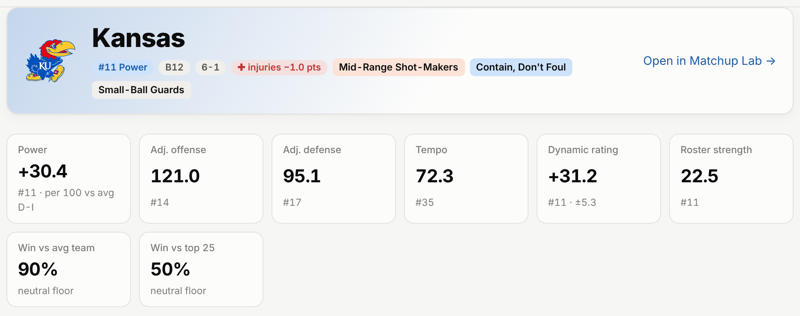
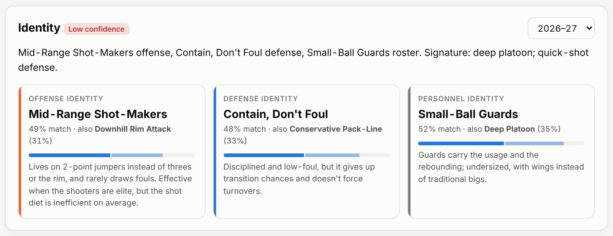
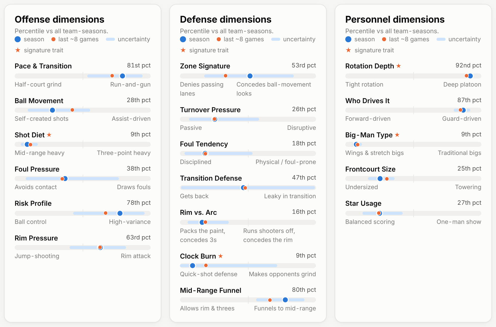
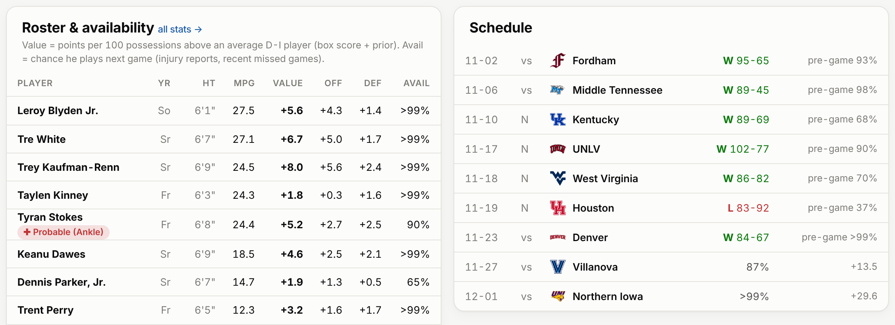
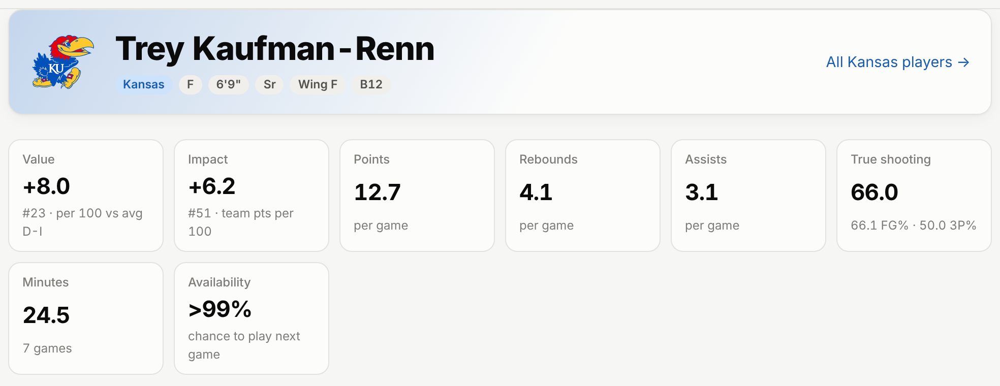
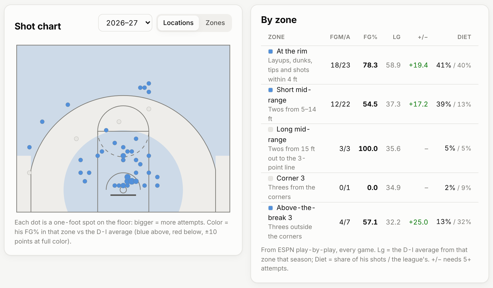
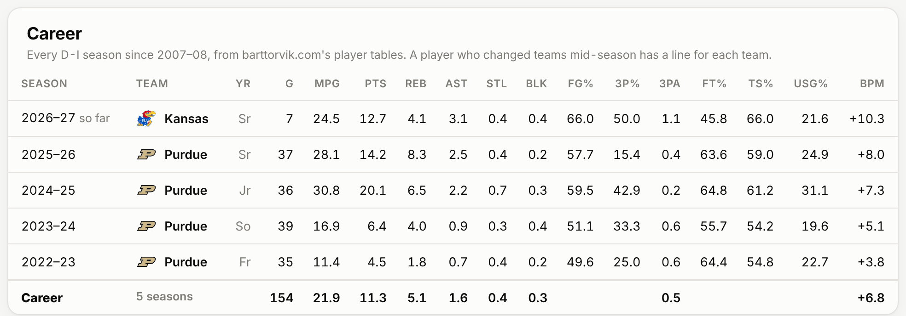

Every team name on [hoop2vec](https://hoop2vec.net/) is a link. Click one and you get a page with just about everything the site knows about that team. Click a player on that page and you get their career. I'll use Kansas for this, partly because they're good this year and partly because I went to grad school there. The screenshots are from the morning of November 26, seven games into the season.

## The top of the page

The header has the basics. Kansas is No. 11 in Power, plays in the Big 12, and is 6-1. The red badge says injuries are costing them about a point per 100 possessions right now. The other three badges are the team's identity, which I'll get to.

Power is the main rating. It's how many points per 100 possessions a team would beat an average Division I team by on a neutral floor. A possession is one trip down the court, and Kansas averages about 72 of them a game. So +30.4 works out to beating an average team by about 22 points.

The next three tiles split that up. Kansas scores 121.0 points per 100 possessions and allows 95.1, both adjusted for who they played and where. Tempo is possessions per 40 minutes. The dynamic rating is a second rating that updates after every game and keeps track of how sure it is. The ±5.3 is that uncertainty, and in November it's pretty wide. Roster strength adds up the player values on the roster, weighted by minutes.

The last two tiles turn Power into odds. Kansas would beat an average team on a neutral floor 90 percent of the time. Against a typical top-25 team it's a coin flip.

## How they play

The identity card describes how a team plays, separately from how good it is. Kansas comes out as Mid-Range Shot-Makers on offense, Contain, Don't Foul on defense, and Small-Ball Guards for personnel. Each label has a match percentage and a runner-up. Kansas is a 49 percent match for Mid-Range Shot-Makers and 31 percent for Downhill Rim Attack.

The labels come from play-by-play data, which logs every shot, rebound, turnover, foul, and substitution. hoop2vec computes a few dozen rates for every team, takes out the part that's just team quality, and groups the rest into style dimensions. The badge at the top says "Low confidence" because seven games isn't much, so early cards still lean on last season.

Right below the card is a list of strengths. The first one says Kansas lives at the rim, with 43.9 percent of its shots there. That sits right under an offense labeled Mid-Range Shot-Makers. Both are true. Kansas takes fewer threes than 93 percent of teams. Almost everything else is a two, either at the rim or from mid-range. The vulnerabilities box says "No clear weak spots yet." I'd give that a few more weeks.

The matchup notes list Contain, Don't Foul defenses as both a matchup Kansas should like and one to watch out for. Those defenses give up transition chances, which Kansas likes. They also take away free throws, which Kansas also likes.

Further down, each dimension gets a slider. The blue dot is the season, the orange dot is the last eight games or so, and the shaded band is the uncertainty. Kansas plays a deep rotation, at the 92nd percentile, and gives very few minutes to traditional big men. Below the sliders is a table with the raw numbers behind them. Kansas gives 9 percent of its minutes to traditional bigs, compared with 21 percent for the average team.

Style barely helps predict games once you know how good both teams are. So the cards are there to describe teams, and the forecasts mostly leave them alone.

## Roster and schedule

The roster table lists every player with their minutes and their Value. Value is how many points per 100 possessions better a team is with that player on the floor than with an average player. It's split into offense and defense. Trey Kaufman-Renn leads Kansas at +8.0.

The last column is availability, the chance a player plays in the next game. It comes from injury reports and recent missed games. Tyran Stokes is listed as probable with an ankle injury, which the site turns into 90 percent. Further down the table, out of frame, Melvin Council Jr. is at 0 percent. He's most of the reason for the injury badge in the header.

The schedule shows every game. Finished games have the score and the win probability the model gave before tip-off. Kansas beat Kentucky as a 68 percent favorite and lost to Houston at 37 percent. Upcoming games have the current win probability and predicted margin.

## Clicking on a player

Every name in the roster is a link. Kaufman-Renn's page starts with the same kind of tiles as the team page. His Value of +8.0 ranks 23rd in Division I. Impact is Value adjusted for playing time. It's what he adds to the team's rating compared with a replacement-level player, the kind any team could find at the end of its bench. His is +6.2, 51st in the country.

Then comes the shot chart. Each dot is a spot on the floor, and bigger dots mean more attempts. The color compares his shooting in that zone with the Division I average. The table next to it has the numbers. He's made 18 of 23 at the rim and 12 of 22 from short mid-range, both way above average. That short mid-range shot is 39 percent of his attempts, compared with 13 percent for a typical player. So the team's Mid-Range Shot-Makers label has a face.

You can switch the chart from exact locations to zones, or pick an earlier season. Exact spots only go back a couple of college seasons, because that's when ESPN started logging where college shots came from. Before that it's zones.

At the bottom is the career table, with a row for every season. Kaufman-Renn spent four years at Purdue before transferring. As a junior he scored 20.1 points a game and used 31.1 percent of Purdue's possessions while he was on the floor. At Kansas he's scoring less, using less, and posting the best box plus/minus of his career. Box plus/minus is a standard estimate of a player's impact from the box score. His is +10.3, but his Value is +8.0, because hoop2vec pulls a seven-game sample back toward what it expected coming into the year.

Men's college careers go back to 2007-08 and come from Bart Torvik's player tables. Women's college careers go back to 2018-19, and NBA and WNBA careers go back to 2008, playoffs included. Those come from ESPN box scores. Every player in all four leagues has a page like this, which is a little over 10,000 shot charts.
