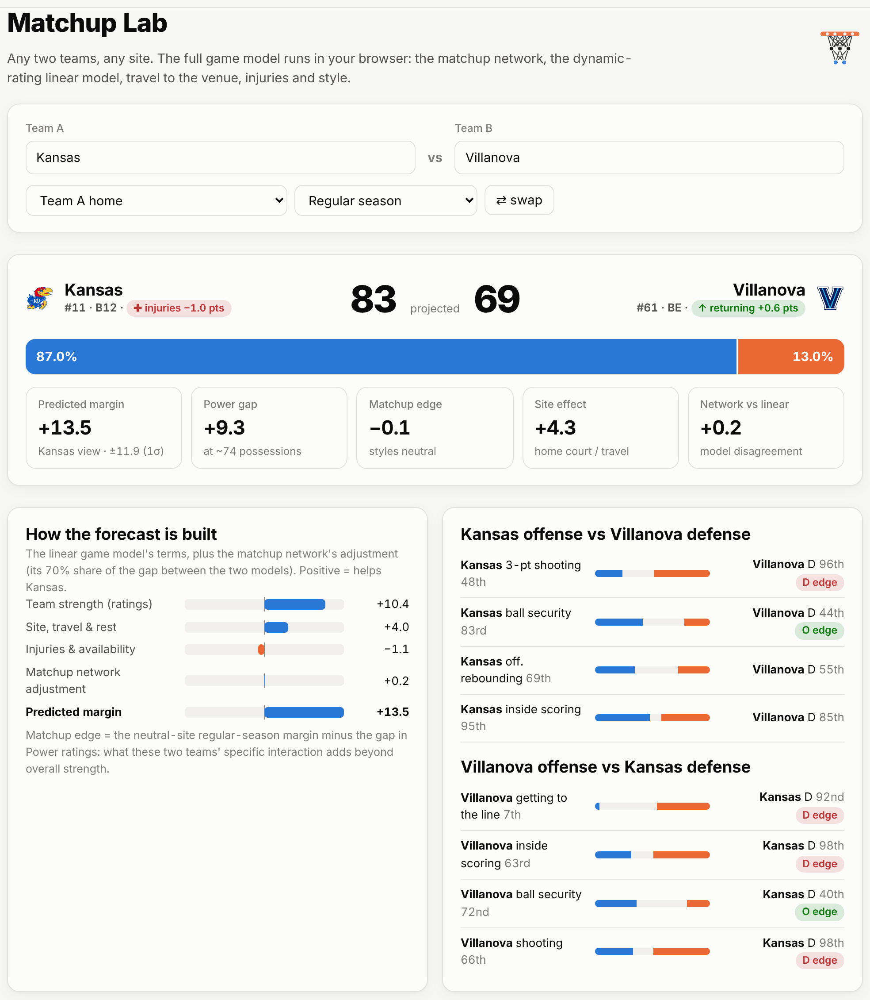

The day before Kansas hosted Villanova, [hoop2vec](https://hoop2vec.net/) had Kansas winning 83 to 69, with an 87 percent chance to win. Every game in all four leagues gets a forecast like that: a predicted score, a margin, and a win probability. They're on each league's Games page and on every team's page. A few minutes after a game ends, the ratings and the next forecasts update, and the whole site gets rebuilt from scratch every morning.

## The Matchup Lab

The Matchup Lab lets you set up any game yourself. You pick two teams, a site, and the type of game, and the full model runs in your browser. It shows the forecast and what each piece added. For Kansas and Villanova, team strength is worth about 10 points to Kansas, home court and travel add 4, and injuries take away 1. Move the game to a neutral floor and Kansas drops to 81 to 71, with a 77.5 percent chance to win.

The right side compares each team's offense with the other team's defense. Villanova's defense ranks in the 96th percentile against threes and Kansas is about average at shooting them. The site marks that as a defensive edge. Kansas doesn't take many threes, so it doesn't move the forecast much.

## Ratings

Underneath every forecast are three team ratings. The first is adjusted efficiency, the approach Ken Pomeroy made famous: points scored and allowed per 100 possessions, adjusted for opponent and venue. A possession is one trip down the court. Counting per possession takes pace out of it, so a slow team that wins 60 to 40 doesn't look worse than a fast team that wins 90 to 70.

The second is a dynamic rating that updates after every game and keeps track of how sure it is. Early in the season it leans on last year's team and how much of the roster came back. The third is Elo, the system chess uses, which is mostly there as a baseline.

Power, the number each league's ratings table is sorted by, comes out of the game model. I ask the model how each team would do on a neutral floor against a set of opponents, then shift the scale so an average team lands at zero. In the pros the opponents are every team in the league. In college they're the top 100. Beating the 350th-best team by 40 doesn't say much about March.

## Players

Player values feed the forecasts too, so the model knows what a team loses when someone sits. Value is how many points per 100 possessions better a team is with a player on the floor than with an average player.

Each league gets it a little differently. Men's college Value starts from box plus/minus, a standard estimate of a player's impact from the box score, adjusted for opponents. Early in the season it leans on last season, class, and recruiting ranking. Women's college basketball doesn't have the same free player stats, so hoop2vec builds its own box plus/minus from ESPN box scores. The first version gave too much credit to whoever grabbed the rebound or made the shot near the basket, which mostly meant the tallest players. I fixed that by shifting some credit between teammates by height within each game.

The NBA and WNBA use lineups instead. When I tried box plus/minus in the pros, efficient, low-usage centers who rebound and block shots came out as some of the best players in the league. So the pro sites use RAPM, which looks at every stretch where the same ten players were on the floor and works out how much each one moved the score. The box score explains about half of a player's offensive impact by that measure, and much less of the defense.

Before each game, every player gets a chance of playing, from injury reports and recent missed games. Missed games mean different things in different leagues. A college player who misses a game is usually hurt. Pros rest. An NBA player who's missed three or more straight games plays the next one only 12 percent of the time. In the first game of the playoffs, that same player plays 76 percent of the time.

## The game model

The forecast blends two models. One is a neural network that takes about 40 numbers for each team, from the ratings to shooting, rebounding, turnovers, roster strength, injuries, rest, and travel. It sees both teams at once, so it can pick up on styles that fit together well or badly. The other is a plain linear model built on team ratings, home court, travel, rest, and injuries. It can't learn matchups, but it's harder to fool.

The backtest picks how much weight each one gets. In men's college basketball and the NBA, the network gets 70 percent. In the women's college game it gets 80. The WNBA has 15 teams and short seasons, so there isn't much data, and the backtest gives the linear model 70 percent there instead.

To test it, I had each league's model predict every past game as if it were the morning of the game. It could only learn from earlier seasons, and it only saw injury news that was public before tip-off. For men's college basketball that's about 82,000 games since 2012, and the model picked the winner in 73.5 percent of them. The score I care more about is log loss, which punishes a confident wrong forecast much harder than an unsure one. In men's and women's college basketball and the NBA, the blend beat each of its parts and every rating it's built from. The WNBA's history is short enough that the models all land within noise of each other.

The toughest comparison is a sportsbook. ESPN carries closing betting lines for some games, and they're more accurate than hoop2vec in men's college basketball and the NBA. The gap is bigger in the NBA, where the betting market is sharper. In women's college basketball hoop2vec slightly beats the few lines ESPN carries. Those markets are thinner, so that's believable, but I don't make much of it.

Around 2020 I spent a lot of my free time trying to beat the stock market, predict elections, and model sports betting. What I found is that an actual edge comes from data other people don't have. A model built on public data usually ends up close to the betting line and a little behind it. hoop2vec is no exception.

## Brackets, playoffs, and the draft

The college sites project the 76-team NCAA tournaments until Selection Sunday, then switch to the real brackets. hoop2vec works out each team's odds of reaching each round exactly, without simulating, because it has a win probability for every possible game. Even the best men's team usually has well under a 50 percent chance to win it all, since it has to win six straight games against good teams. There also aren't enough tournament games to tell models apart. In 936 past men's tournament games, every reasonable model I tested landed within noise of the others.

The pro sites play out the rest of the regular season 10,000 times, then apply the tiebreakers, the NBA play-in, and each league's playoff format. In past NBA playoff series, hoop2vec did a fair amount better than just picking the team with home court.

The college sites also have a Prospects page with two models. One estimates each player's chance of being drafted in each tier, from the top 5 down to getting picked at all. The other estimates the chance a player becomes a real contributor in the pros. In testing, an average of 20 of the model's top 30 players were drafted, compared with about 15 for a simple baseline. Pro teams are still better at this than I am. They get workouts, medical reports, and interviews, and I get box scores.

Each league has a Method page with the details and every backtest number, including the ones where the sportsbook wins.
