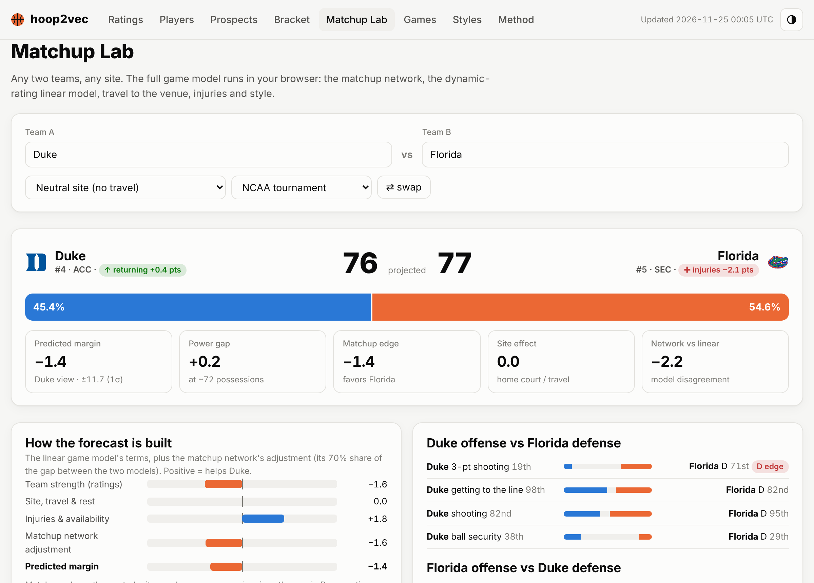

Duke plays at Florida on December 1. [hoop2vec](https://mkearney.github.io/hoop2vec/#/games) has Florida winning 78 to 73, with a 68 percent chance. Every D-I game gets a forecast like that, on the Games page and on each team's page, and they update every morning.

Move the same game to a neutral floor and it's close to a coin flip. Florida's chance drops to 55 percent. The Matchup Lab lets you set up any game that way: pick two teams and a site, and the full model runs in your browser and shows how much each piece mattered.

## How it works

The forecast blends two models. One is a neural network that takes about 40 numbers for each team, from both ratings to shooting, rebounding, turnovers, roster strength, injuries, rest, and travel. It sees both teams at once, so it can pick up on styles that match up well or badly. The other is a plain linear model built on team ratings, home court, travel, rest, and injuries. It can't learn matchups, but it's harder to fool. The final forecast is 70 percent network and 30 percent linear, a split I picked by testing different weights on past seasons.

The model also estimates how uncertain each game is. For Duke and Florida it's about 12 points, meaning the final margin should land within 12 points of the prediction about two times out of three.

To test it, I had the model predict every D-I game from 2012 through 2026 as if it were the morning of the game. It could only learn from earlier seasons, and it only saw injury news that was public before tip-off. That's about 82,000 games, and it picked the winner in 73.5 percent of them. The score I care more about is log loss, which punishes a confident wrong forecast much harder than an unsure one. On that, the blend beat both of its parts and every rating it's built from.

## Against the books

The real test is a sportsbook. ESPN carried DraftKings closing lines for about 5,500 games last season, and the lines were a little more accurate than the model, with a log loss of 0.542 against 0.547. The same has been true so far this season.

Around 2020 I was burned out from open-source work and the never-ending demands of teaching, research, and mentoring. So naturally I spent my free time trying to beat the stock market, predict elections, and model sports betting. What I found is that models are powerful and informative, but the real edge comes from data other people don't have, or from knowing something they don't. Public data gets you close to the market. It doesn't get you past it.

So that's not what hoop2vec is for. It's for giving myself information that's easy to digest, as accurate as I can make it, and easy to make sense of: who's actually good, who's overrated, which teams are worth following, and which ones would be fun to pencil in on a bracket.
