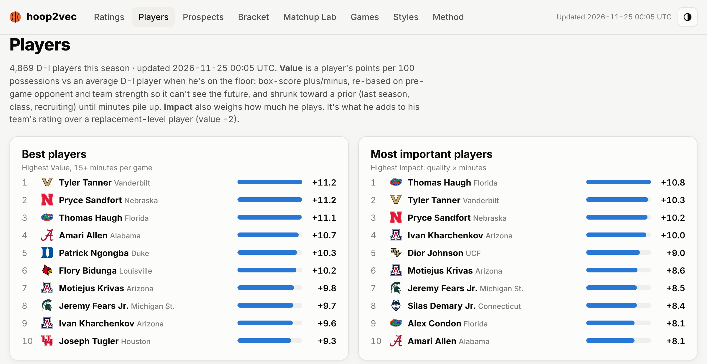

Florida is playing without Boogie Fland, who's out with a shoulder injury. He'd been playing about 25 minutes a game, and as long as he's listed as out, [hoop2vec](https://mkearney.github.io/hoop2vec/#/players) takes about two points off Florida in every forecast. That adjustment comes from the Players page, which rates every D-I player.

Each player gets two numbers. Value is how many points per 100 possessions better his team is with him on the floor than it would be with an average D-I player. Impact adds playing time. It's what he adds to his team's rating compared with a replacement-level player, the kind of guy any team could find at the end of its bench. A great player who plays 15 minutes a game doesn't add as much as a very good one who plays 35.

Right now the top Value belongs to Vanderbilt's Tyler Tanner, a 6-foot junior guard, at +11.2. The top Impact belongs to Thomas Haugh, a 6-foot-9 senior at Florida who plays 33 minutes a game and is making 51 percent of his threes. So Florida is down a rotation guard, but it still has the most important player in the country.

Value starts from box plus/minus, a standard way to estimate a player's contribution from his box score. hoop2vec adjusts each game for the strength of his team and the opponent as of that morning. Early in the season there isn't much to go on, so the number starts from a prior built on what he did last season, the usual jump for his class, and his recruiting ranking. As minutes pile up, this season takes over. A freshman with five good games is still partly rated on his recruiting ranking, and by February he won't be.

Injuries come from public injury reports, which hoop2vec reads every morning. A healthy player counts at 100 percent, a questionable one at 50, and a player ruled out at zero. The team ratings already reflect who's been playing, so the adjustment only counts the difference between who's available now and who usually plays. If a starter has missed the last three games, the ratings already know. If he's out tonight for the first time, the forecast moves.
