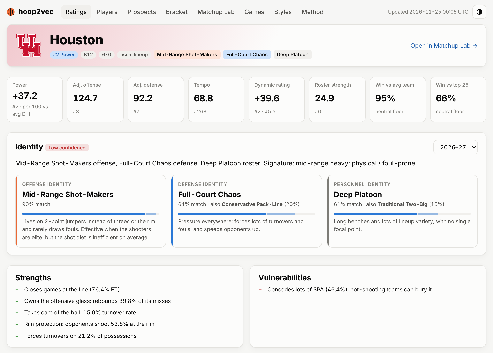

Houston forces a turnover on about one in five possessions, takes a lot of mid-range jumpers, rebounds 40 percent of its own misses, and sends opponents to the line often. [hoop2vec](https://mkearney.github.io/hoop2vec/#/team/houston) calls that a Mid-Range Shot-Makers offense, a Full-Court Chaos defense, and a Deep Platoon roster.

Every team gets an identity card like this one, describing how it plays separately from how good it is. The Styles tab has all the dimensions and archetypes, and which teams fit each one.

## How it's built

The cards start from play-by-play data, which logs every shot, rebound, turnover, foul, and substitution. From that I compute about 32 rates for each team, like how often it shoots in transition, where its shots come from, how many of its baskets are assisted, and how often it ends up shooting late in the shot clock. Each rate is adjusted for opponents and home court, and pulled toward average when there isn't much data yet.

Then I take team strength out. Good teams make more shots and turn it over less, and I didn't want a style score that was really just a quality score. What's left goes through factor analysis, which finds groups of rates that tend to move together. Transition shots, pushing the ball after defensive rebounds, and short possessions all rise and fall together, so they become one dimension called Pace & Transition. There are six of these for offense, seven for defense, and five for the roster.

Teams also get archetypes, which are clusters of teams with similar profiles, and a team can sit between two of them. Houston is a 64 percent match for Full-Court Chaos and a 20 percent match for Conservative Pack-Line.

Each card lists strengths, vulnerabilities, and matchup notes, with the numbers behind them. Houston's lists Run-and-Gun Bombers as both a favorable matchup and a risky one. Its defense takes away transition chances, which those teams want, and it also gives up a lot of threes, which they also want. It's early, so most cards are marked low confidence and still lean partly on last season.

## What it doesn't do

Style barely helps predict games. Adding these dimensions to the forecasts improved log loss by about 0.001 over all games, which is tiny, and by nothing measurable in March. Almost everything a matchup tells you is already in how good the two teams are. So the forecasts leave the identities out, and the cards are there to describe teams.
