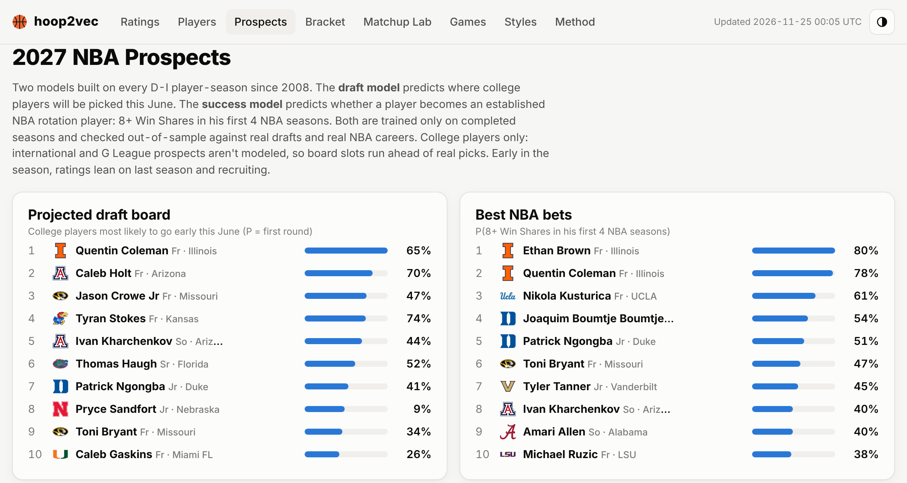

I've always thought the eye test was worth something. Not just for seeing a player's skills, but for seeing how competitive he is and what his drive is like. I knew Marcus Smart and Christian Braun were going to play hard at the next level. I could tell Trae Young was going to be a difficult talent to fit around, and that Andrew Wiggins didn't have the killer instinct you'd want. That's all fun. But for the most part, who gets drafted and who sticks in the NBA can be modeled with reasonable accuracy.

The [Prospects page](https://mkearney.github.io/hoop2vec/#/prospects) on hoop2vec runs two of those models on every D-I player. Right now its top prospect is Quentin Coleman, an 18-year-old freshman guard at Illinois who's averaging 20.7 points a game. It gives him a 65 percent chance of going in the first round.

## Two models

The draft model estimates the chance a player is picked in the top 5, in the lottery (the top 14), in the first round, and at all. It learned from every D-I player-season since 2008 and who actually got drafted.

The success model estimates the chance a player gets 8 or more Win Shares in his first four NBA seasons. Win Shares is a stat that splits a team's wins among its players, and eight over four years is about what a steady rotation player gets. Players who went undrafted or never reached the NBA are in the data too, as misses.

Both models use the same inputs: age, height, class, recruiting ranking, team and conference strength, role, and about 30 stats adjusted for opponents. Age matters more than anything else. A freshman putting up good numbers at 18 is a much better bet than a senior putting up the same numbers at 23.

## How well it works

I tested both models one draft at a time, training each only on earlier drafts. From 2012 through 2026, an average of 20 of the model's top 30 players were drafted. A simple baseline using recruiting ranking, box plus/minus, and age got about 15.

NBA teams are still better at this than I am. For players who were drafted, where they were picked predicts their NBA careers better than my success model does, and adding my model to the draft slot didn't improve on the slot alone. Teams get workouts, medical reports, and interviews. I get box scores. The model also only covers college players, so international and G League prospects aren't on the board, and its slots run ahead of where players will really go.

Each prospect also gets comps. A separate model learns how college stats turn into NBA stats over a player's first four seasons, then finds past college players at the same stage whose projected NBA profile is closest. Coleman's closest comps include V.J. Edgecombe, Jeremiah Fears, and Dylan Harper, three freshman guards picked in the top seven in 2025. Some things carry over better than others. Rebounding, blocks, assists, and how many threes a player takes translate well. Shooting efficiency and overall impact translate much less.

None of this is hard to show. ESPN, KenPom, or Sports Reference could offer this kind of detail in a way that's easy to use. They also have years of existing pages and habits to work around, and I got to start from scratch.
