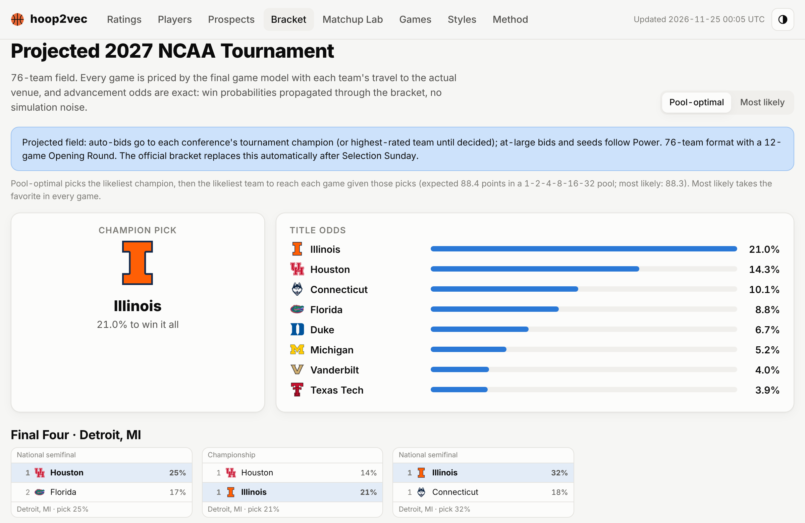

The 2027 NCAA tournament will have 76 teams, up from 68, with a 12-game Opening Round before the usual round of 64. [hoop2vec](https://mkearney.github.io/hoop2vec/#/bracket) already has a projected bracket for it, with each team's odds of reaching each round.

Until Selection Sunday the field is a projection. Each conference's automatic bid goes to its tournament champion, or to its highest-rated team until that tournament is played, and at-large bids and seeds follow Power, the site's team rating. After Selection Sunday the real bracket replaces the projection automatically.

## Exact odds

Most bracket models simulate the tournament thousands of times and count how often each team wins. hoop2vec works out the odds exactly. It has a win probability for every possible game, including each team's travel to that game's site, so it can calculate each team's chances round by round without any simulation noise.

Right now Illinois has a 21 percent chance to win the title. That's the best of any team, and it still means Illinois loses somewhere along the way about four times out of five. Houston is second at 14 percent, and Connecticut is the only other team above 10 percent.

## Picks

I've spent a lot of time over the years trying to predict upsets. One approach was to predict how many upsets would happen in a round, given the matchups, and then force that many of the most likely ones into my picks. hoop2vec doesn't do anything like that. Its picks come straight from the probabilities.

It fills out a bracket two ways. Most likely takes the favorite in every game. Pool-optimal is built for a pool that scores rounds 1, 2, 4, 8, 16, and 32 points, so it picks the likeliest champion first and works backward from there. Right now the two brackets are close, and both expect about 88 points out of a possible 192.

Winning a pool takes more than being right. You also want to be right when the other people in your pool are wrong. hoop2vec doesn't know what your coworkers are picking, so it can't help with that part.

March is also just hard to predict. In 936 past tournament games, every reasonable model I tested landed within noise of the others, including a plain efficiency rating. A single tournament is 75 games, which isn't nearly enough to tell good models apart.
